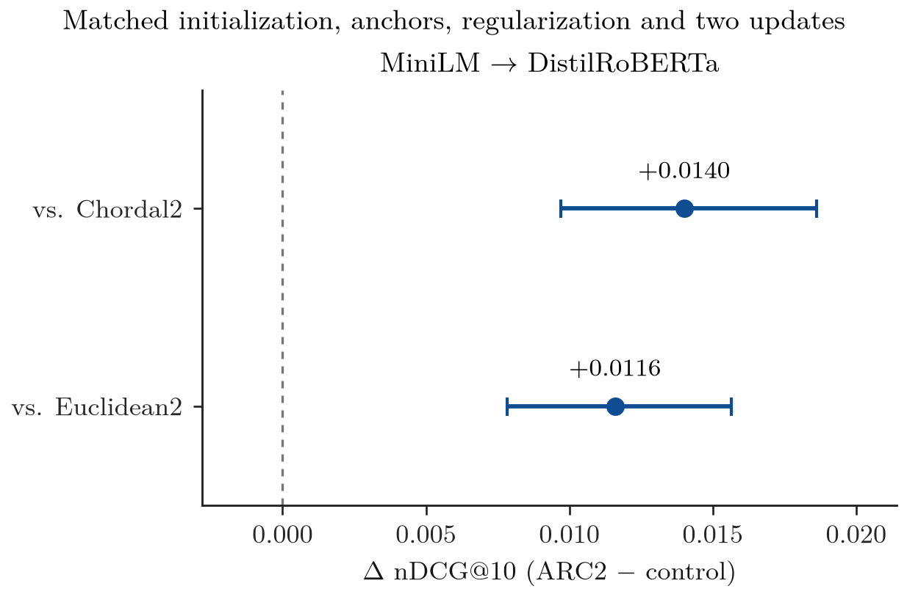

# FiQA matched-residual ablation — TC1L MiniLM local

**Complete and locally verified.** Primary contrasts: 2 positive, 0 negative, 0 unresolved.

FiQA development; 57,638 documents, 500 queries, 1,024 fitted anchors, 50% paid exposure (28,819 unique documents including anchors), five seeds, exact search. No new encodings or neural training.

| Method | MiniLM nDCG@10 | MiniLM Recall@100 |
|---|---:|---:|
| Procrustes initialization | 0.285828 | 0.668792 |
| EuclideanResidual2 | 0.295915 | 0.674000 |
| Chordal2 (norm-matched) | 0.293506 | 0.674006 |
| ARC2 Tangent2 | 0.307505 | 0.676569 |

## Locked primary comparisons

| Encoder transition | ARC2 minus control | Delta nDCG@10 | Corrected interval | Verdict |
|---|---|---:|---|---|
| minilm_distilroberta | Chordal2 (norm-matched) | +0.013999 | [+0.009704, +0.018621] | positive |
| minilm_distilroberta | EuclideanResidual2 | +0.011589 | [+0.007821, +0.015656] | positive |

Four prespecified two-sided contrasts; only two MiniLM contrasts observed here, both E5 contrasts pending. Five-seed averaging precedes paired query bootstrap (20,000 draws); individual98.75% percentile intervals, approximate95% original-family coverage. Recall/B0 are descriptive.

Tangent versus chordal isolates radial target inclusion conditional on this computation. Tangent versus Euclidean also changes prediction-norm weighting. These are already-inspected DEV results, not independent confirmation or universal-best evidence.

## Seed consistency (descriptive)

| Seed | ARC2 minus Chordal2 | ARC2 minus EuclideanResidual2 |
|---|---:|---:|
| 17 | +0.014092 | +0.011658 |
| 29 | +0.014442 | +0.013170 |
| 41 | +0.014135 | +0.011446 |
| 53 | +0.012807 | +0.009614 |
| 67 | +0.014519 | +0.012059 |

Both control comparisons have positive nDCG mean differences in all five fixed seeds. This is descriptive seed consistency, not five independent confirmation studies.

Intervals in the figure are individual98.75% intervals preserving the originalK4 contrast family; E5 remains pending.

## Resources and verification

- synthetic: SYNTHETIC_PASS; 3.4 seconds; peak RSS 57.9 MiB.
- smoke: SMOKE_SEALED; 14.6 seconds; peak RSS 506.0 MiB.
- full: FULL_SEALED; 71.3 seconds; peak RSS 514.6 MiB.

Shared Procrustes/factor timings and per-arm phase times are diagnostic, not standalone deployment-cost measurements.

Local QA PASS: all20 rankings and20,000 per-query metric values checked against labels; maximum metric difference 2.22e-16; bootstrap difference 0.

Protocol: `protocols/TC1L_MINILM_LOCAL_20261102.md`; distinct Windows measurement; E5 pending. Historical runs and manuscript remain unchanged.

**STOP:** interpret this finite ablation before any manuscript edit, method change, regrade or new study.
